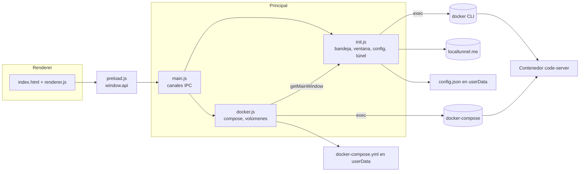

# Arquitectura — VSCodeWeb (vs-code-web-win-setup)

## 1. Módulos
| Módulo | Proceso | Responsabilidad |
|---|---|---|
| `src/main.js` | principal | Punto de entrada (`package.json:main`). Registra los canales IPC y delega en `init.js` y `docker.js`. |
| `src/init.js` | principal | Bandeja, ventana, `config.json`, auto-arranque, verificación de Docker, iniciar/detener servicios y túnel. Registra `app.on('ready')`. |
| `src/docker.js` | principal | Genera, lee y guarda `docker-compose.yml`; selector de carpetas; `up -d` / `down`. |
| `src/preload.js` | puente | Expone `window.api` con `contextBridge`. |
| `src/index.html` + `src/renderer.js` | renderer | Formularios de red y Docker, lista de volúmenes, botones de contenedor. |

## 2. Diagrama de componentes

## 3. Cómo se hablan
- **Renderer → principal**: `ipcRenderer.invoke` / `send` mediante `window.api` (`src/preload.js:3-22`). Canales: `load-config`, `save-config`, `read-docker-compose-file`, `save-docker-config`, `mount-docker-container`, `update-docker-container`, `delete-docker-container`, `select-folder`.
- **Principal → renderer**: `loadConfig` (al terminar de cargar la ventana, `src/init.js:133-136`), `updateTunnelUrl` (`src/init.js:278`), `docker-config-saved` (`src/main.js:25`).
- **Bandeja → servicios**: las opciones Start, Stop y Restart llaman directo a funciones de `init.js` (`src/init.js:152-160`), sin pasar por IPC.
- **Dependencia circular**: `docker.js` importa `getMainWindow` de `init.js`; `init.js` no importa `docker.js`.

## 4. Modelo de datos
Dos archivos en `app.getPath('userData')` (ver `docs/ERS.md` §6). Estado en memoria: `dockerConfig` (copia del compose, `src/docker.js:26`), `volumePaths` (lista en el renderer, `src/renderer.js:2`), `tunnel`, `tray`, `mainWindow`.

## 5. Despliegue
Instalador NSIS creado con `electron-builder` (`npm run build` → `dist/`), `perMachine: true`, accesos directos de escritorio y menú inicio (`package.json`). El repo incluye un instalador ya compilado `VSCodeWeb Setup 1.0.0.exe` (~78 MB) versionado en git. Desarrollo: `npm install && npm start`. Sin CI.

## 6. Dependencias externas
| Dependencia | Uso |
|---|---|
| electron ^31 / electron-builder ^25 | Runtime y empaquetado. |
| js-yaml ^4 | Leer y escribir el compose. |
| auto-launch ^5 | Auto-arranque con Windows. |
| localtunnel ^2 | Túnel público. |
| Docker Desktop, `docker`, `docker-compose` | Se asumen instalados (no se empaquetan). |
| Imagen `codercom/code-server:latest` | Descargada por Docker en el primer `up`. |
| CDN Bootstrap, jQuery, Popper | Interfaz. |
