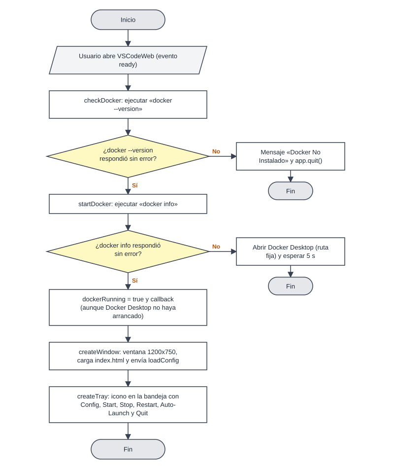
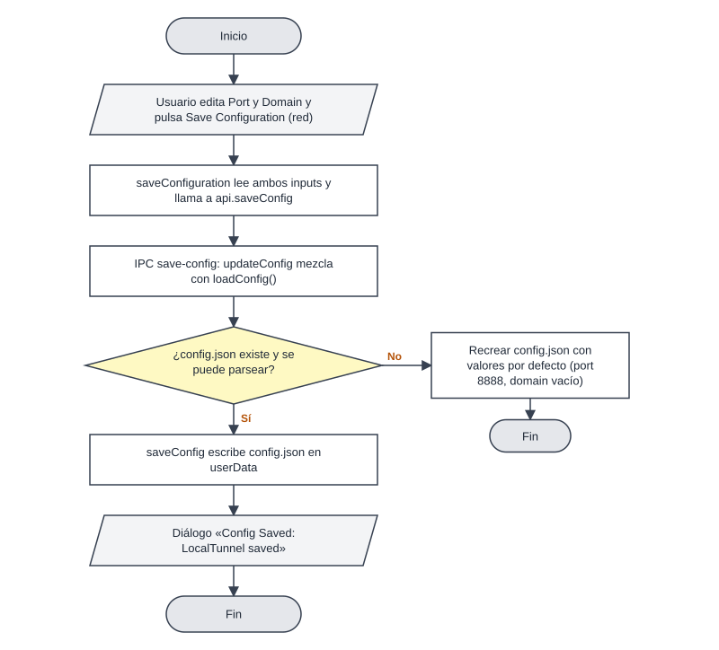
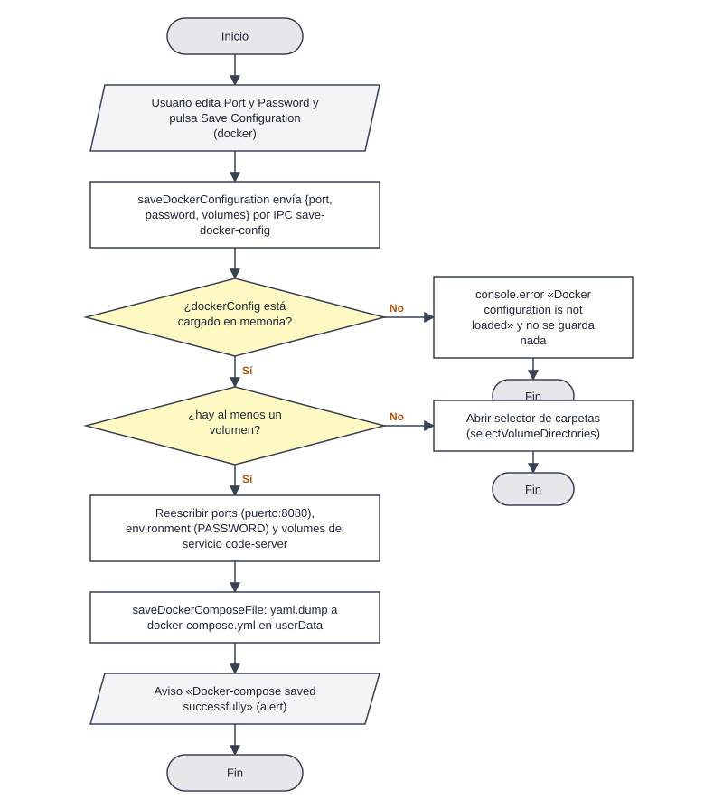
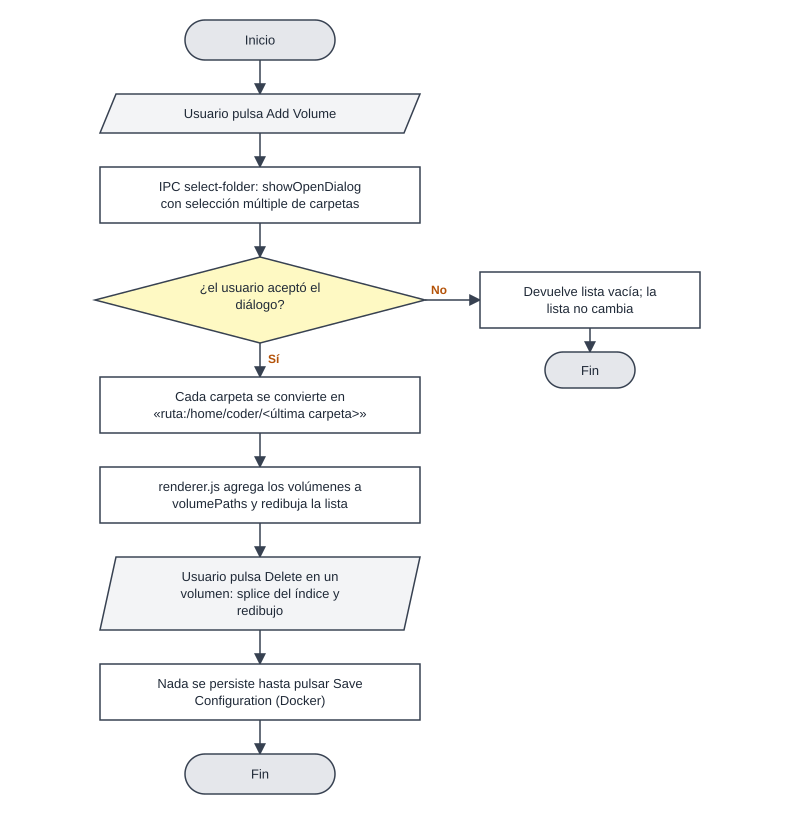
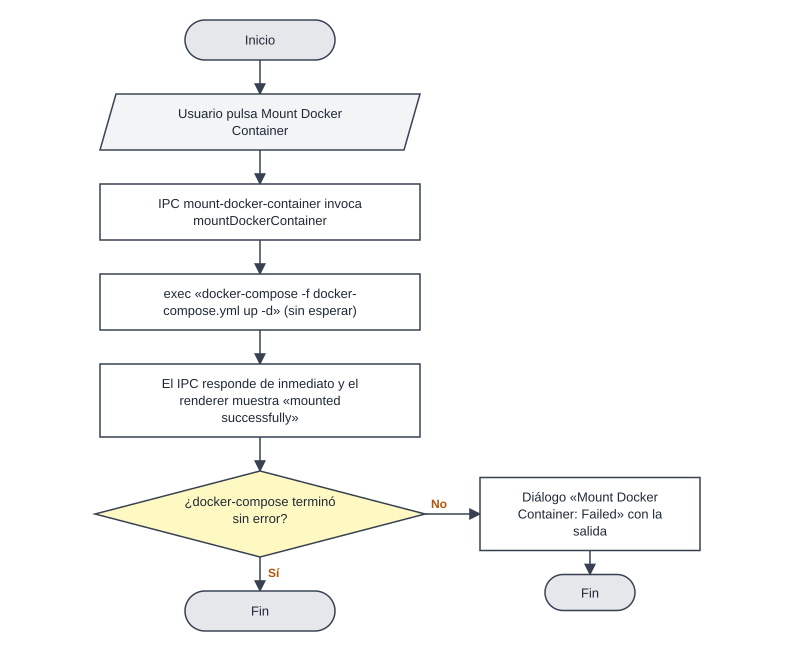
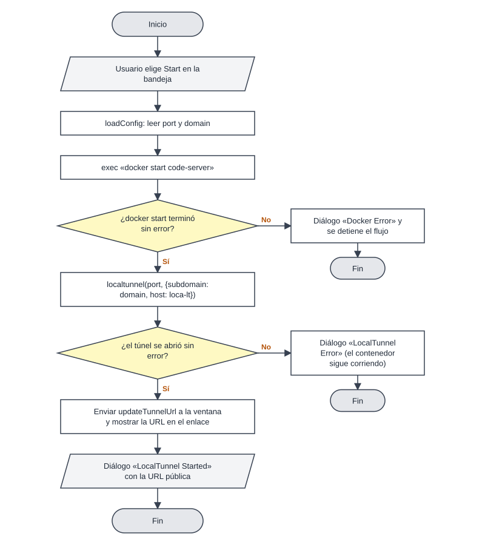
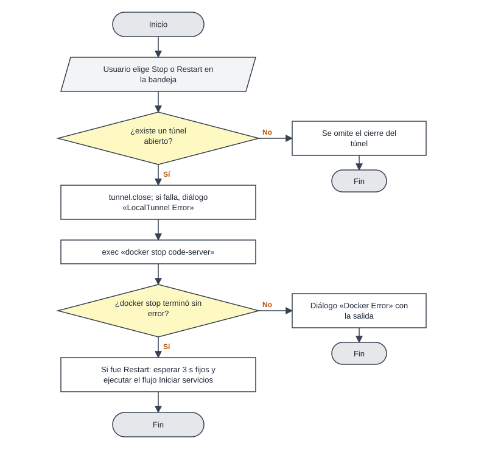
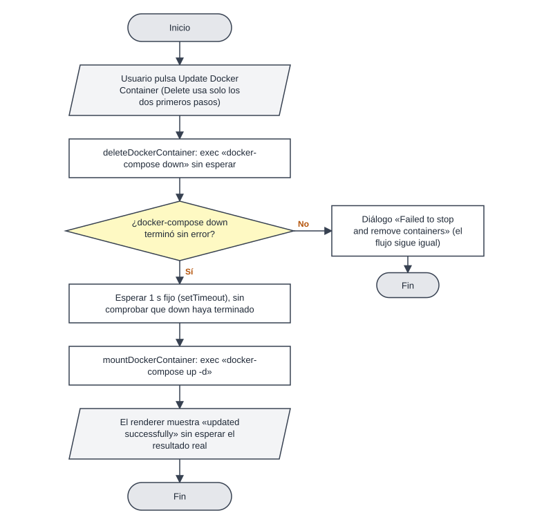
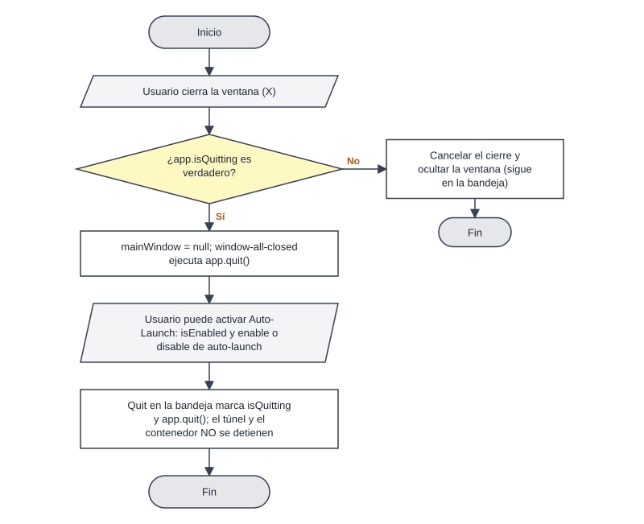

# Flujos principales — VSCodeWeb (vs-code-web-win-setup)

Diagramas en estilo PSeInt (óvalo = Inicio/Fin, rectángulo = proceso, paralelogramo = entrada/salida, rombo = decisión con ramas «Sí»/«No»). Los rombos corresponden a `if`/guardas reales del código; cada paso cita `archivo:línea`. En los rombos, «Sí» sale hacia abajo y «No» hacia la derecha, salvo donde la pregunta está invertida y se indica en el propio rombo.

Índice: 1 Arranque · 2 Guardar dominio y puerto del túnel · 3 Guardar configuración de Docker · 4 Volúmenes · 5 Montar el contenedor · 6 Iniciar servicios · 7 Detener y reiniciar · 8 Actualizar y eliminar · 9 Cierre y auto-arranque.

---

## 1. Arranque de la aplicación

1. Al evento `ready` se ejecuta `checkDocker` (`src/init.js:345-350`), que corre `docker --version` (`:192`).
2. Si falla: diálogo «Docker No Instalado» y `app.quit()` (`:193-195`). Si no, pasa a `startDocker` (`:197`).
3. `startDocker` ejecuta `docker info` (`:203`). Si responde bien, marca `dockerRunning = true` y sigue (`:233-236`).
4. Si falla, avisa «Running Docker, please wait…» (`:204-210`) y lanza Docker Desktop con una ruta fija (`:212-214`). Si no puede lanzarlo muestra «No se Puede Iniciar Docker» pero igual continúa (`:215-221`); si lo lanza, espera 5 s y reintenta `docker info`, y continúa sea cual sea el resultado (`:221-233`).
5. El callback crea la ventana y la bandeja (`:346-349`). `createWindow` abre `index.html` y le envía `loadConfig` al terminar de cargar (`:109-132`).
6. En paralelo, `docker.js` crea el compose por defecto si no existe (`src/docker.js:237-239`).

## 2. Guardar dominio y puerto del túnel

1. La interfaz carga `config.port` y `config.domain` en los inputs al cargar (`src/index.html:119-127`).
2. «Save Configuration» (formulario de red) llama a `saveConfiguration`, que lee los dos inputs y envía `save-config` (`src/index.html:130-136`).
3. `updateConfig` lee la config actual con `loadConfig` (`src/init.js:67-70`). Si el archivo no existe o no parsea, lo recrea con valores por defecto (`:17-40`).
4. Mezcla los valores y `saveConfig` escribe `config.json` y muestra «LocalTunnel saved» (`:52-65`).
5. Los valores no se validan; un cambio de puerto aquí NO cambia el compose (ver B-07).

## 3. Guardar configuración de Docker

1. «Save Configuration» (formulario Docker) llama a `saveDockerConfiguration`, que envía `{port, password, volumes}` a `save-docker-config` (`src/renderer.js:105-112`, `src/main.js:23-26`).
2. `updateDockerConfig` aborta con un error en consola si `dockerConfig` no está cargado (`src/docker.js:116-119`); la interfaz igual muestra el aviso de guardado.
3. Si la lista de volúmenes llega vacía, abre el selector de carpetas (`:121-123`).
4. Reescribe `ports` como `<puerto>:8080`, `environment` completo (con `PASSWORD`) y `volumes` (`:125-132`).
5. `saveDockerComposeFile` serializa con `yaml.dump` y escribe el archivo (`:81-90`).
6. El principal emite `docker-config-saved` y el renderer lo muestra con `alert` (`src/main.js:25`, `src/renderer.js:138-140`).

## 4. Agregar y quitar carpetas montadas

1. «Add Volume» llama a `window.api.selectFolder` (`src/renderer.js:142-145`), que invoca el canal `select-folder` (`src/main.js:40-42`).
2. `selectVolumeDirectories` abre `showOpenDialog` con selección múltiple; si se cancela devuelve `[]` (`src/docker.js:143-150`).
3. Cada ruta se transforma en `ruta:/home/coder/<carpeta>` (`:152-155`).
4. El renderer concatena en `volumePaths` y redibuja la lista (`src/renderer.js:147-165`).
5. «Delete» hace `splice` en `volumePaths` y redibuja (`:114-135`). No hay confirmación y nada se escribe a disco hasta guardar la configuración de Docker.

## 5. Montar el contenedor

1. «Mount Docker Container» llama a `mountDockerContainer` por IPC (`src/renderer.js:171-175`, `src/main.js:28-30`).
2. Ejecuta `docker-compose -f "<userData>/docker-compose.yml" up -d` sin esperar el resultado (`src/docker.js:193-195`).
3. La función no devuelve promesa: el IPC responde enseguida y el renderer muestra «mounted successfully» aunque el comando todavía corra o falle.
4. Si el comando falla, un diálogo informa «Failed:» con el segundo argumento del callback, que en `exec` es la salida estándar, no el error (`:195-203`); ver B-11.

## 6. Iniciar servicios (Start) — contenedor y túnel

1. Opción Start de la bandeja (`src/init.js:152-160`) llama a `startServices` (`:246`), que lee `port` y `domain` (`:247-249`).
2. `docker start code-server` (`:252`). Si falla, diálogo «Docker Error» y termina (`:253-257`). El contenedor debe existir (haber hecho Mount antes).
3. Abre el túnel con `localtunnel(port, {subdomain, host: "https://localtunnel.me"})` (`:261-264`). Si hay error, diálogo y termina; el contenedor queda corriendo (`:265-272`).
4. Guarda la instancia, envía `updateTunnelUrl` a la ventana (`:279-282`) y muestra «LocalTunnel is running at» (`:284-292`).
5. Registra manejadores de cierre y error del túnel (`:299-308`).

## 7. Detener y reiniciar servicios

1. Stop llama a `stopServices` (`src/init.js:315`). Si existe `tunnel`, lo cierra y avisa si falla (`:316-327`).
2. Ejecuta `docker stop code-server`; si falla, diálogo «Docker Error» (`:330-338`).
3. Restart llama a `stopServices`, espera 3 s fijos y llama a `startServices` (`:340-343`); no espera a que el stop termine.

## 8. Actualizar y eliminar el contenedor

1. Delete llama a `deleteDockerContainer`: `docker-compose -f ... down` sin esperar (`src/docker.js:209-226`).
2. Update llama a `updateDockerContainer`: `deleteDockerContainer`, `setTimeout` de 1 s y `mountDockerContainer` (`:230-235`). Si `down` tarda más de 1 s, `up -d` arranca encima (ver B-12).
3. El renderer muestra «updated/deleted successfully» al instante (`src/renderer.js:177-187`).

## 9. Cierre de ventana, salida y auto-arranque

1. El evento `close` de la ventana se cancela y se oculta salvo que `app.isQuitting` sea verdadero (`src/init.js:121-128`).
2. Con Quit de la bandeja se marca `isQuitting` y se llama `app.quit()` (`:172-177`). El túnel y el contenedor no se detienen (B-13).
3. Auto-Launch alterna `enable`/`disable` de `auto-launch` y recrea la bandeja, pero `createTray` sale si ya existe (`:87-106,148-150`), por lo que la casilla puede no refrescarse (B-14).
4. Doble clic en la bandeja o «Config» muestran/crean la ventana (`:157-160,181-188`).
